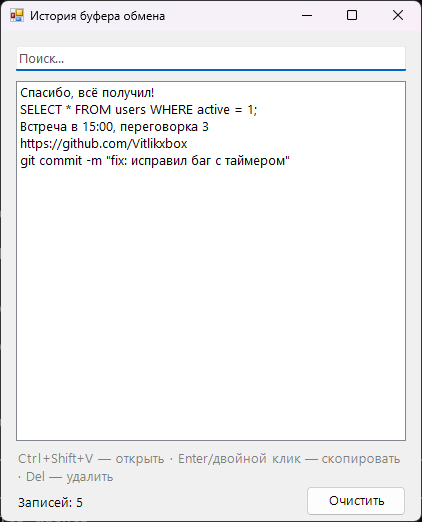

<div align="center">

# 📋 ClipboardHistory

**История буфера обмена для Windows: всё, что ты копировал, под рукой**




</div>

## ✨ Возможности

- 📚 Запоминает последние 100 скопированных текстов
- ⌨️ **Ctrl+Shift+V** открывает окно из любой программы
- 🔍 Мгновенный поиск по истории
- ♻️ Повторы не дублируются, а поднимаются наверх
- 📥 Работает в трее: закрытие окна не останавливает запись
- 🔒 История хранится **только в памяти** и нигде не сохраняется на диск

## ⌨️ Управление

| Клавиша | Действие |
|:---:|---|
| <kbd>Ctrl</kbd>+<kbd>Shift</kbd>+<kbd>V</kbd> | Открыть историю |
| <kbd>↓</kbd> из поиска | Перейти к списку |
| <kbd>Enter</kbd> / двойной клик | Скопировать запись |
| <kbd>Del</kbd> | Удалить запись |

Выйти из программы можно правой кнопкой по иконке в трее, пункт «Выход».

## 📥 Установка

1. Скачай `ClipboardHistory.exe` из раздела [**Releases**](../../releases/latest)
2. Запусти его, установка не нужна

## 🛠️ Сборка из исходников

Нужен только Windows: компилятор C# входит в состав .NET Framework.

```bat
build.bat
```

## 📄 Лицензия

[MIT](LICENSE)
